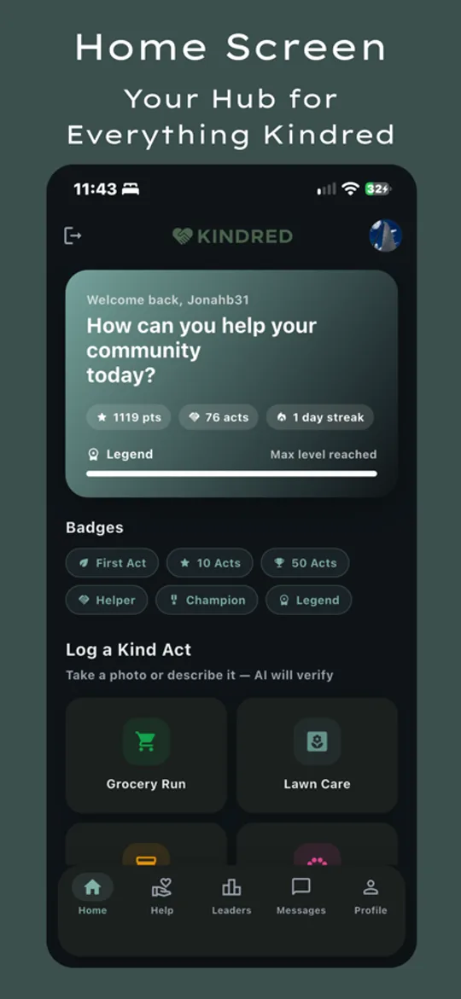
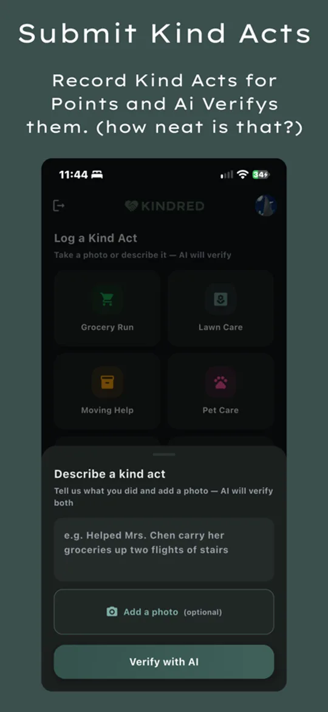

# Kindred

**A neighborhood kindness app.** Post a small favor you need done and let a neighbor nearby
volunteer to help — or browse what your neighbors need and be the one who shows up.

Kindred is a complete, shipping app: a Flutter client (iOS, Android, and web) on top of Firebase,
with a small Cloudflare Worker for the parts a client can't be trusted to do. It is live on the
App Store and used by real people.

**[App Store](https://apps.apple.com/app/id6826042911)** · **[Web app](https://kindred.smartlights.lol)** · **[Android APK](https://github.com/jonahb344-ai/kindred/releases/latest/download/kindred.apk)**

 

## What it does

- **Post & claim requests** — Grocery Run, Lawn Care, Moving Help, Pet Care, Meal Prep, a Ride,
  or anything else. Requests appear on a map and in a feed, filtered to your neighborhood radius.
- **Neighborhood map** — requests are shown as areas, not addresses: each one is placed at a
  random point within a quarter mile of the poster, so nobody's exact home is published.
- **In-app chat** — a private thread per request so the helper and the requester can coordinate.
- **Points, levels & badges** — every completed act earns points; helpers climb from Helper to
  Champion to Legend.
- **AI kindness verification** — a completed act is checked by an AI model before points are
  awarded, so the scoreboard can't be farmed by doing nothing.
- **Push + in-app notifications** — new claims, confirmations, and messages, delivered by FCM
  through the Worker.
- **Safety** — report and block, content rules enforced server-side in `firestore.rules`, and
  account deletion that also anonymizes the requests you had claimed.

## How it works

```
Flutter app (iOS · Android · web)
  ├── Firebase Auth ............ Google, Apple, and email sign-in
  ├── Cloud Firestore .......... requests, chats, notifications, feed, users
  ├── flutter_map + Esri tiles . neighborhood map (no Google Maps, no billing)
  ├── geolocator ............... device location, permission-gated
  └── firebase_messaging ....... push token registration
            │
            │  HTTPS + Firebase ID token (Authorization: Bearer)
            ▼
Cloudflare Worker (worker/worker.js)
  ├── POST /verify ................. AI kindness check (Gemini, Claude fallback)
  ├── POST /push ................... FCM v1 send, requires the request id
  ├── POST /notifyNearby ........... fan out to neighbors within the radius
  ├── POST /phone .................. shares a phone number only between matched users
  ├── POST /anonymizeVolunteered ... service-account cleanup on account deletion
  └── GET  /admin/ai-health ........ provider health check
```

Two deliberate design choices:

1. **Coordinates are never exact.** A request stores `approxLat`/`approxLng` — a random point
   inside the poster's radius — never their real `lat`/`lng`.
2. **Private data has its own home.** Phone numbers, push tokens, and saved location live in
   `users/{uid}/private/data`, which clients cannot read. Only the Worker (service account) or
   the owner can touch it.

## Tech stack

| Layer | Choice |
| --- | --- |
| Client | Flutter / Dart, single-activity app, custom design system (Poppins, no Material defaults) |
| Auth | Firebase Auth — Google, Apple, email/password |
| Data | Cloud Firestore with security rules in `firestore.rules` |
| Map | `flutter_map` + free Esri World Street Map / World Imagery tiles |
| Push | Firebase Cloud Messaging v1, sent by the Worker |
| Server | Cloudflare Worker (no Cloud Functions, no servers to maintain) |
| AI | Gemini Flash Lite primary, Claude Haiku fallback |
| CI/CD | GitHub Actions: signed APK, unsigned IPA, App Store Connect upload on tag |

## Run it locally

### 1. Prerequisites

- Flutter 3.x with the platform toolchain you want (Xcode for iOS, Android Studio for Android;
  the web build needs nothing extra)
- A Firebase project of your own — the checked-in config points at the production one, and you
  should not run your own build against it

### 2. Point the app at your Firebase project

```bash
dart pub global activate flutterfire_cli
flutterfire configure          # rewrites lib/firebase_options.dart for your project
```

Then in the Firebase console:

- Enable **Authentication** → Google, Apple, and Email/Password
- Create **Cloud Firestore** and deploy the rules: `firebase deploy --only firestore:rules`
- For push, add your Android SHA-1 and your iOS APNs key

### 3. Run the app

```bash
flutter pub get
flutter run                    # pick a device, or:
flutter run -d chrome          # web build in a browser
```

`flutter analyze` and `flutter test` both pass on a clean checkout (0 errors; a handful of style
lints are expected).

### 4. Run the Worker (optional)

Everything except AI verification, push, phone sharing, and neighbor broadcasts works without it.
If you want the full app:

```bash
cd worker
npx wrangler deploy
npx wrangler secret put SERVICE_ACCOUNT      # Firebase service account JSON
npx wrangler secret put GEMINI_API_KEY
npx wrangler secret put ANTHROPIC_API_KEY    # optional fallback
```

`kServerBaseUrl` in `lib/main.dart` is the one place the app points at the Worker.

### 5. Build a release

```bash
flutter build apk --release      # build/app/outputs/flutter-apk/app-release.apk
flutter build web --release      # build/web
```

Pushing a `v*` tag runs `.github/workflows/release.yml`, which builds the signed APK, the unsigned
IPA, uploads the build to App Store Connect, and publishes both as release assets.

## Project structure

```
lib/main.dart            the whole app: screens, widgets, design system, Firestore calls
lib/firebase_options.dart  generated by flutterfire configure
worker/worker.js         Cloudflare Worker: verify, push, notifyNearby, phone, cleanup
worker/wrangler.toml     Worker config
firestore.rules          Firestore security rules (deployed separately)
scripts/migrate_approx.js  one-off migration: exact coords -> approximate coords
test/widget_test.dart    unit tests for level thresholds and banner palette
docs/                    README screenshots
```

## Privacy

- Only approximate locations are stored for requests; exact coordinates are never written.
- Phone numbers and push tokens live in a subcollection clients cannot read.
- Deleting your account removes your requests, chats, notifications, and profile — and
  anonymizes any requests you had claimed, so the other person's history stays intact without
  your name on it.
- Blocking someone hides their requests from you and yours from them.

## Contributing

Issues and pull requests are welcome. Keep `flutter analyze` at zero errors and make sure
`flutter test` passes before opening a PR.

## License

[GPL-3.0](LICENSE) — free to use, study, and build on, as long as derivative work stays open.
